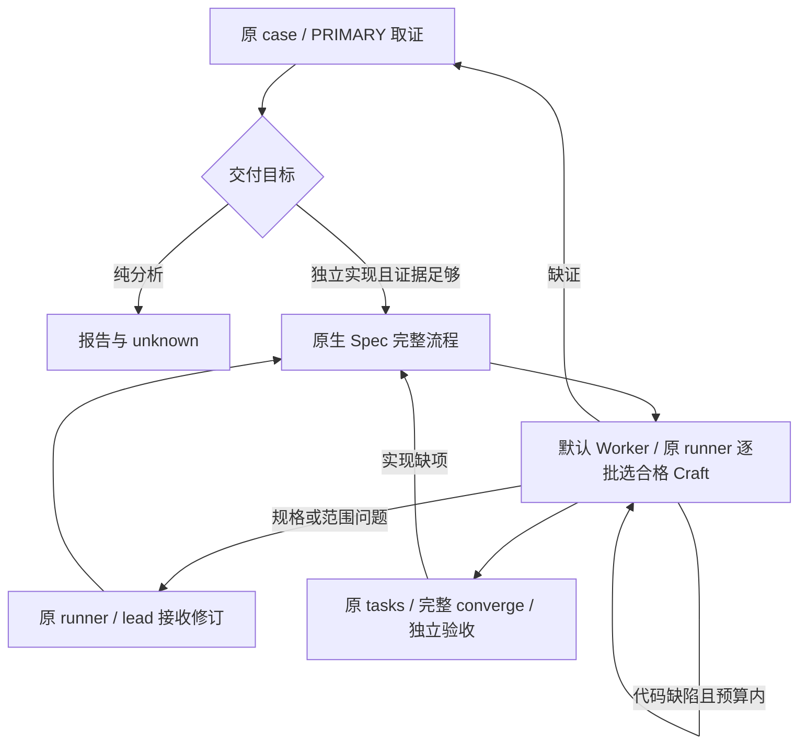

# Reverse 工作流使用手册

你只需要说明目标，并在真正需要取舍时复制选项。文件检查、技术路线、工具选择、取证、验证和失败后的换路由智能体完成。安装步骤见 [快速开始](quick-start.md)，实际能力与未验证项见 [兼容记录](compatibility.md)。

## 零基础一键开始

在成果项目目录中开始对话，填写目标路径和你想得到的结果：

```text
/skill:reverse-workflow

我是零基础。目标在 ./[文件名]，我想知道[具体功能]如何工作，之后视证据考虑做独立实现。
先只检查文件，不运行目标、不联网、不修改原件；允许在当前项目保存分析记录和提取材料。
技术方法由你判断，在范围和预算内持续推进，用大白话汇报。
真正需要我决定目标、对象、影响范围或交付结果时，给我可复制的 A/B/C 或编号选项。
不要让我选择技术工具，也不要每步问“继续吗”。
```

上例允许保存分析资料。如果你要求完全零写入，应明确说“只读审查，不写任何文件”；此时原路由使用 dry-run，不创建 case。命名目标只确定对象，运行、联网、设备操作和修改副本仍以你实际说明的范围为准。

## 什么时候需要你选择

目标清楚时直接执行，不要求你重选。只有结果或影响有实际差别时才显示选项，例如：

```text
A. GOAL-LOGIC：先解释指定功能及关键逻辑，给出证据和未知项。（推荐）
B. GOAL-RECONSTRUCT：证据足够后，在独立项目实现指定功能并和原版比较。
```

你可以复制整行，也可以回复 `A`、`1` 或该行的稳定 ID。编号只对应当次展示的选项，过期或含糊时智能体会澄清，不会猜成新的授权。普通话表达同样有效，例如“先解释这个功能”。不需要启用宿主的其他 GOAL 模式。

没有真正分叉时，智能体直接说明下一步并继续。工具超时、静态分析受阻、方法切换或请子代理复核属于内部处理。你不需要选择 REA、Ghidra、Frida、Static/Dynamic、脱壳、dump 或 IAT。

## 目标、范围和交付分开

这些 ID 用来保持跨会话含义稳定。智能体只展示当前适用的少量选项，不会一次把整表当成必填菜单。

| 类别 | ID | 含义 |
|---|---|---|
| 目标 | `GOAL-REPORT` | 查明并报告当前能证明的内容 |
| 目标 | `GOAL-LOGIC` | 解释指定行为与关键逻辑 |
| 目标 | `GOAL-RECONSTRUCT` | 证据足够后独立实现指定功能 |
| 目标 | `GOAL-COMPARE` | 比较原版与指定实现的行为 |
| 目标 | `GOAL-UPDATE` | 复用旧项目，适配指定新版本 |
| 范围 | `SCOPE-STATIC-ONLY` | 只检查文件，不运行目标 |
| 范围 | `SCOPE-ISOLATED-RUNTIME` | 在明确的隔离环境运行指定副本 |
| 范围 | `SCOPE-AUTHORIZED-DEVICE` | 在明确授权的设备上执行列出的动作 |
| 范围 | `SCOPE-WORKCOPY` | 修改指定工作副本并保留原件和回滚 |
| 交付 | `DELIVERY-REPORT` | 证据报告和限制 |
| 交付 | `DELIVERY-CORE` | 指定核心功能及验证结果 |
| 交付 | `DELIVERY-COVERAGE` | 约定覆盖矩阵和回归结果 |
| 交付 | `DELIVERY-UNKNOWN` | 收束当前结果，保留未验证项 |

ID 只是类别。每次范围卡要列出具体目标、动作、环境、网络、预算和清理条件。允许修改副本不等于允许运行；允许运行不等于允许联网、改系统或安装到真实设备。选独立实现也不扩大目标运行权限。

例如必须运行目标才能确认下一项时，应给出已填好具体环境的选项：

```text
A. SCOPE-ISOLATED-RUNTIME：允许在[已核实的隔离环境]运行[指定副本]，禁网，限时[预算]，结束后清理自有进程。（推荐）
B. SCOPE-STATIC-ONLY：继续只检查文件；只能通过运行确认的行为保持未知。
```

方括号应由智能体根据当前项目填写。缺少只有你能提供的文件、设备身份或账号时，直接问该项，不把它包装成无关菜单。

## 加壳或难分析时会怎样

智能体先固定原件哈希、范围和预算，再检查保护特征和可用证据。能从静态材料回答的问题先做定向检查；遇到运行时加载、反调试、虚拟化或不可读导入表时，在已有授权内选择下一种观察方式。

失败要留下方法、条件、输出、未知项和清理记录。同一失败条件不应无限重复；没有范围内的可行方法就说明阻碍。缺少运行授权时保持未知或给范围选项，不会因为“加壳”自动运行目标。dump 是某一时刻的内存材料，反编译文本是分析产物，都不代表恢复了原作者源码。

## 授权逻辑不能只改一个地方就算完成

授权、许可证或功能门可能位于主程序、插件、Java/native、缓存、在线检查、设备绑定、更新/心跳或完整性自检中。智能体必须先建立当前范围的组件和检查点清单，再逐行绑定目标身份、证据、预期行为、改动、回归与回滚。

例如只能说：

```text
已验证 1/7 个授权面；其余 6 个尚未完成。
主程序的检查点已通过，插件、缓存、在线状态和相邻功能仍需验证。
```

一个补丁写入成功、一个功能能用、程序启动成功或退出码为 0，都不能把整体任务标成完成。修改导致别的功能异常时，相关行重开；失败、未知、受阻或未检查的 required 行继续阻止整体完成声明。减少交付范围是你决定的结果取舍，不是智能体自行删掉未通过项。

## 独立实现与源码恢复

行为证据足够后，reverse 才交接到 reconstruction；Spec Kit 在独立成果项目负责规格、计划、任务和测试。目标行为不明确时先补证据，不能用“合理猜测”填成原版规格。需要实现时直接复制 [quick-start 的完整复刻提示词](quick-start.md#需要独立复刻项目时)，由智能体核原生指令与本机资格；用户只表达意图和任务输入，不需手选技术工具。



图只作导航：返回仍遵原生合同，规格问题回原 runner、范围问题回 lead；原 runner 接收返回并确认旧写者清理后再调度，cleanup unknown 先停止新写者。Craft 补证或交接变更须由原 owner 接收新引用/decision/selection，冻结新批次与 fresh run root。单批 candidate、Ready、exit 0 和 installer accept 不代表完整任务或业务 accepted，具体闭环以同一复制模板及安装版原生合同为准。

| 等级 | 当前能支持的声明 |
|---|---|
| L0 | 完成身份与保护特征分诊 |
| L1 | 得到可读反编译或伪代码 |
| L2 | 理清关键调用和数据流 |
| L3 | 建立指定行为模型 |
| L4 | 独立实现通过核心差分测试 |
| L5 | 约定边界、错误、状态、副作用与回归测试通过 |
| L6 | 源码、符号、构建材料支持近原始源码恢复 |

L3 是分析进展，L4/L5 才涉及实跑的独立实现。报告应说明测试了什么、未测试什么、使用哪个版本和环境，不能把 L3/L4 写成“完整源码恢复”。规格符合、原版行为对照、隔离独立运行分别验收。

## 继续旧项目与跟随更新

```text
/skill:reverse-workflow
继续这个项目。先核对原 case、目标版本、scope、证据、回归结果和上次未知项，再在原范围内继续。已有回答不要重问。
```

更新版本时：

```text
上游从[旧版]变成[新版]。沿用我们的实现和界面，只适配有证据支持的变化并重新验证。保留旧证据和回滚，不把旧版通过当成新版通过。
```

continuity 保存的是恢复指针。旧记录的来源变了就需要复核，模型上次说“成功”不会因此成为证据。case、target 和分支不一致时不能混用。新会话先恢复原资料；多个目标有歧义时只澄清依赖该身份的工作。

## Grilling 的位置

Grilling 用于你明确要求的访谈，或尚未确定的重要目标、范围、产品行为和交付取舍。事实题由智能体查证。已确定的目标不会在换工具、阶段汇报或每次修改前重新访谈。进入访谈后遵守官方规则；installer 只生成独立 wrapper，官方文件和行为保持不变。

## 进度与交付

较长任务用简短更新说明当前发现、实际阻碍与下一步。已确定范围内连续推进；重要的目标、范围或交付取舍与用户澄清。

交付时给出可定位的结果与证据，说明实际验证范围和剩余问题。涉及覆盖或运行活动的结论，按原专业契约提供适用的覆盖、回归及清理依据；详细记录保存在原 case 中。

## 维护者的核对入口

- reverse 的 `RULES.md`、`skills/ops/guided-operator-contract.md` 是行为/交互契约。
- `skills/reverse-engineering/references/re-agent-workflow.md` 定义受 scope 约束的内部转场。
- `skills/ops/authorization-coverage.md` 与其只读 checker 核对覆盖和引用；机械通过不证明原始证据语义真实。
- `skills/reconstruction/SKILL.md` 定义 L0–L6、Evidence handoff 与差分验收。
- `verify` 检查安装身份；`accept` 运行基础工具验收；宿主加载、模型行为与真实目标行为分别验证。本组合是指令和检查工具，不是 OS 沙箱或任意模型的可靠性保证。
